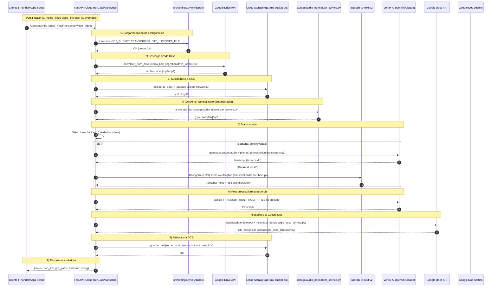
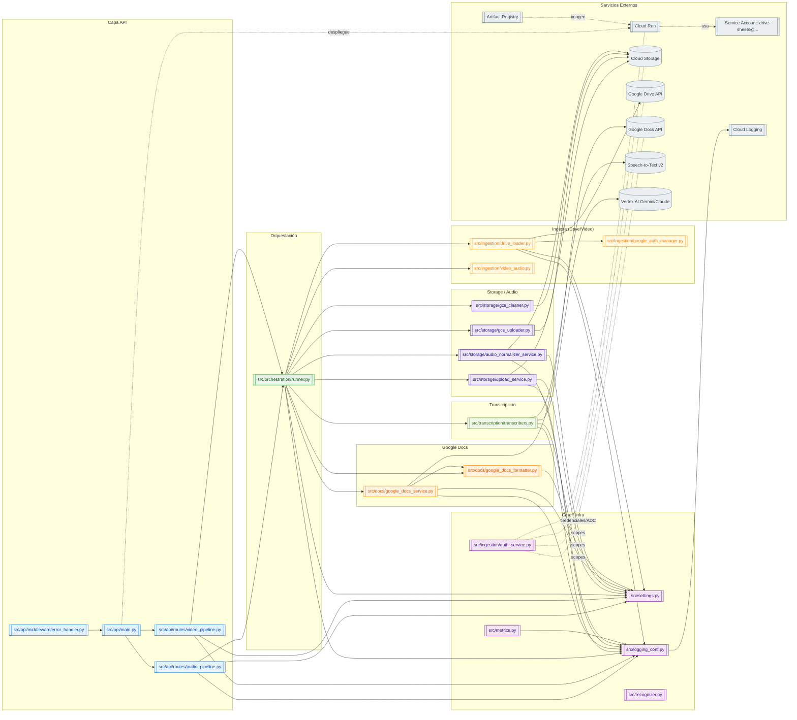

# TMF Audio/Video Transcription API (GCP / Cloud Run ready)

Servicio FastAPI que:

1. **Descarga** audio/video desde Google Drive
2. **(Opcional) Normaliza** audio (volumen/formato/SR) y lo sube a GCS
3. **Transcribe** con **Gemini (Vertex)** o **Speech-to-Text v2**
4. **Escribe** la transcripción en un **Google Doc existente** (recibe `doc_id`) con **formato** (título, fecha, estilos)
5. **Guarda** copia `.txt` en GCS
6. Expone **/metrics** (Prometheus) y **/api/health**

> **Cuenta de servicio** usada en tiempo de ejecución: `drive-sheets@ortega-473114.iam.gserviceaccount.com`

---

## 🌳 Estructura clave

```
src/
  api/
    main.py
    routes/
      audio_pipeline.py        # POST /api/transcribe (audio desde Drive)
      video_pipeline.py        # POST /api/transcribe-video (video desde Drive → MP3)
    middleware/
      error_handler.py         # Formato de errores + logging
  docs/
    google_docs_formatter.py   # Genera requests de formato (título, estilos, alineación)
    google_docs_service.py     # Llama a Docs API (append / replace)
  ingestion/
    drive_loader.py            # extract_drive_id(), download_from_drive(...)
    video_audio.py             # extract_audio_to_mp3(...) con ffmpeg
    google_auth_manager.py     # get_drive_docs() (SA u OAuth - aquí usamos SA)
    auth_service.py            # Credenciales Service Account (Drive/Docs)
  orchestration/
    runner.py                  # run_transcription_pipeline_to_doc(...)
                               # run_transcription_pipeline_from_gcs(...)
  storage/
    upload_service.py          # Sube archivo local a GCS (upload_to_gcs)
    gcs_uploader.py
    gcs_cleaner.py
    audio_normalizer_service.py# Normaliza y convierte a FLAC/WAV (cuando aplica)
  transcription/
    transcribers.py            # gemini_vertex_transcribe_gcs, stt_v2_transcribe_gcs, LRO, etc.
  logging_conf.py
  metrics.py
  recognizer.py
  settings.py
```

## 🧠 Arquitectura

### 1) Vista general (flujo funcional)



### 2) Vista técnica (módulos y dependencias)



---

## ⚙️ Prerrequisitos

* **Python 3.11+**
* **Google Cloud Project** con APIs:

  * Google **Drive API**
  * Google **Docs API**
  * **Cloud Storage**
  * **Vertex AI** (para Gemini-Vertex) y/o **Speech-to-Text v2**
* **Service Account** con permisos:

  * Acceso **editor** al **Doc** *de destino* (lo comparte el Apps Script al crearlo)
  * Acceso a los **archivos de Drive** de origen (compartidos o en Shared Drive)
  * Permisos en **GCS bucket** (p.ej. `roles/storage.objectAdmin` sobre el bucket)
* (Opcional para video) **ffmpeg** instalado localmente o definir `FFMPEG_BIN` (ruta absoluta)

---

## 🔐 Variables de entorno (.env)

Ejemplo mínimo:

```env
# GCP / Credenciales
GCP_PROJECT_ID=ortega-473114
GCP_REGION=us-central1
GOOGLE_APPLICATION_CREDENTIALS=./credencial/sa.json

# Buckets
USE_GCS=true
GCS_BUCKET=my-bucket-out
GCS_BUCKET_OUTPUT=my-bucket-out

# Backend de transcripción (default si no hay override)
TRANSCRIBER=gemini_vertex   # gemini_vertex | stt_v2

# STT (defaults)
STT_ENGINE=google
STT_LANGUAGE_CODE=es-ES
STT_ENABLE_DIARIZATION=false
# Toggles de normalización para STT
NORMALIZE_FOR_STT=true
STT_TARGET_CODEC=flac       # flac | wav
STT_TARGET_SR=8000          # 8000 recomendado para telefonía

# Prompt (opcional)
TRANSCRIPTION_PROMPT_FILE=./src/domain/prompts/transcription_prompt.md.j2
GEMINI_API_KEY=             # (Sólo si usaras AI Studio; en Vertex no hace falta)

# (Opcional) ffmpeg
FFMPEG_BIN=C:/ffmpeg/bin/ffmpeg.exe
```

> **No** subas `sa.json` ni `.env` al repo.

---

## 🚀 Instalación y ejecución local

```bash
python -m venv venv
source venv/bin/activate        # Windows: venv\Scripts\activate
pip install -r requirements.txt

# Exporta/define .env (o usa dotenv)
uvicorn src.api.main:app --reload --port 8080
```

* **Health**: `GET http://127.0.0.1:8080/api/health`
* **Métricas**: `GET http://127.0.0.1:8080/metrics` (Prometheus text format)

---

## 📑 Contrato API

### 1) Transcribir **audio** de Drive → anexar al Doc

`POST /api/transcribe`

**Body**:

```json
{
  "case_id": "julio",
  "title": "eficiencia operativa",
  "media_link": "https://drive.google.com/file/d/1LJtgNV6CUwlRoxPfRAT-dJcNCRANMZMX/view?usp=drive_link",
  "doc_id": "1JgSDjvvAmgq5ChY0qAdcUDFGx28lXuPrM25x0FXmr9U",
  "language_code": "es-ES",
  "diarization": false,
  "model": "latest_long",
  "transcriber": "stt_v2"
}
```

**Headers opcionales**:

* `X-Transcriber: gemini_vertex | stt_v2`  *(tiene prioridad sobre el body)*

**Response**:

```json
{
  "case_id": "julio",
  "title": "eficiencia operativa",
  "backend": "stt_v2",
  "doc_id": "1JgSDjvvAmgq5ChY0qAdcUDFGx28lXuPrM25x0FXmr9U",
  "duration_ms": 55325,
  "timestamp": "2025-10-28T16:37:58.334123Z"
}
```

> También devuelve header `X-Backend: stt_v2 | gemini_vertex`.

### 2) Transcribir **video** de Drive → (extrae MP3) → anexar al Doc

`POST /api/transcribe-video`

**Body**:

```json
{
  "case_id": "julio",
  "title": "eficiencia operativa",
  "video_link": "https://drive.google.com/file/d/AAA.../view?usp=drive_link",
  "doc_id": "1JgSDjvvAmgq5ChY0qAdcUDFGx28lXuPrM25x0FXmr9U",
  "language_code": "es-ES",
  "transcriber": "gemini_vertex"
}
```

> Requiere **ffmpeg**. Si no está en `PATH`, define `FFMPEG_BIN`.

---

## 🎚️ Selección de backend

Orden de precedencia:

1. **Header** `X-Transcriber`
2. **Body** `transcriber`
3. **.env** `TRANSCRIBER` (por defecto)

**Valores soportados**:

* `gemini_vertex` → Consume **MP3 directo** desde GCS (rápido, sin normalizar).
* `stt_v2` → Por defecto **normaliza** a FLAC/WAV.
  Puedes desactivar la normalización con `NORMALIZE_FOR_STT=false` para consumir **MP3 directo** y ganar velocidad.

---

## 📝 Formato en Google Docs

El servicio **apendea** al final del Doc con:

* **Título** + **sello de fecha**
* Transcripción **línea a línea**, respetando:

  * `[[00:05]]` → `[00:05]`
  * Líneas tipo `[tt] Speaker: contenido` → cabecera en **negritas** y contenido debajo
  * Líneas tipo `[tt] [Nota: ...]` → **itálica** y **gris**
* Alineación **izquierda** en todo el rango insertado

> El **Apps Script** creador del Doc debe **compartir** el documento con la SA o crearlo en un **Shared Drive** accesible por la SA.

---

## 🧪 Ejemplos rápidos

### Curl (audio)

```bash
curl -X POST http://127.0.0.1:8080/api/transcribe \
  -H "Content-Type: application/json" \
  -H "X-Transcriber: stt_v2" \
  -d '{
    "case_id":"julio",
    "title":"eficiencia operativa",
    "media_link":"https://drive.google.com/file/d/1LJt.../view?usp=drive_link",
    "doc_id":"1JgSDjvvAmgq5ChY0qAdcUDFGx28lXuPrM25x0FXmr9U",
    "language_code":"es-ES"
  }'
```

### Apps Script (fetch)

```js
UrlFetchApp.fetch("http://127.0.0.1:8080/api/transcribe", {
  method: "post",
  contentType: "application/json",
  headers: { "X-Transcriber": "gemini_vertex" },
  payload: JSON.stringify({
    case_id: "julio",
    title: "eficiencia operativa",
    media_link: "https://drive.google.com/file/d/1LJt.../view?usp=drive_link",
    doc_id: "1JgSDjvvAmgq5ChY0qAdcUDFGx28lXuPrM25x0FXmr9U",
    language_code: "es-ES"
  }),
});
```

---

## 📊 Métricas y salud

* `GET /api/health` → `{ "status": "ok" }`
* `GET /metrics` → métricas Prometheus (latencias, conteos, errores por backend, etc.)

---

## 🧯 Errores comunes (y cómo resolver)

* **400** `Invalid insertText index` en Docs

  * Aseguramos *offset* al final del body (`endIndex - 2`). Ya contemplado en `google_docs_service.py`.
* **403/404** al descargar de Drive

  * Verifica que el **archivo** está **compartido** con la SA o vive en un **Shared Drive** accesible.
* **403** al escribir en Docs

  * Asegura que el **Doc** está compartido con la SA (editor) o en un Shared Drive.
* **ALTS creds ignored** (warning)

  * Informativo en local; ignóralo.
* **ffmpeg** no encontrado

  * Instala ffmpeg o define `FFMPEG_BIN` con la ruta del binario.

---

## 🏭 Despliegue (Cloud Run – pista rápida)

1. Agrega `ffmpeg` al contenedor si vas a usar `/api/transcribe-video`.
2. Monta `GOOGLE_APPLICATION_CREDENTIALS` como **secret** o var de entorno.
3. Concede a la **SA de ejecución** permisos en GCS y Vertex/STT según el backend.

*(Si quieres, te dejo un `Dockerfile` con ffmpeg estático en otro momento.)*

---

## 📄 Licencia

Consulta el archivo **LICENCE** en la raíz.

---

## 💬 Soporte y mantenimiento

* **Logs** enriquecidos y tiempos por fase (`metrics.py`)
* **Override** de backend por header/body
* **Toggles** de normalización en STT
* **Formato** en Docs robusto (con opción a *fallback* a texto plano si lo habilitas después)
