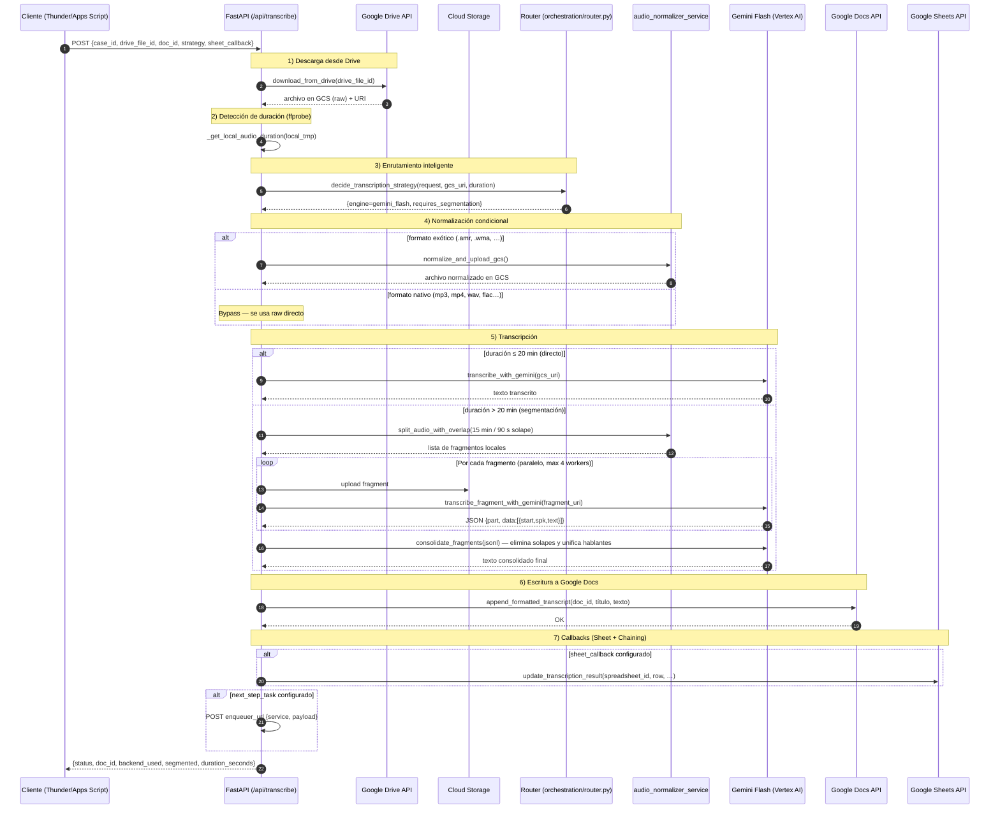

# TMF Audio/Video Transcription API (GCP / Cloud Run ready)

Servicio FastAPI que transcribe audios y videos de Google Drive usando **Gemini Flash como motor único**, con segmentación automática para archivos largos (>20 min).

## Características principales

1. **Descarga** audio/video desde Google Drive
2. **Detección automática de duración** con `ffprobe` para decidir la estrategia
3. **Gemini Flash como motor único** para toda transcripción (audio, video, llamadas)
4. **Segmentación automática** para audios >20 min:
   - División en fragmentos de 15 min con 90 s de solapamiento (`ffmpeg -c copy`, sin pérdida)
   - Transcripción **paralela** de fragmentos (hasta 4 workers simultáneos)
   - **Consolidación inteligente** con Gemini Flash: elimina repeticiones y unifica hablantes
5. **Normalización condicional**: solo para formatos exóticos; Gemini consume MP3/MP4 directo
6. **Escribe** la transcripción en **Google Docs** con formato (título, fecha, estilos)
7. **Actualiza Google Sheets** con resultados (estado, enlace, motor usado, duración)
8. **Respaldo automático** de la transcripción como `.txt` en GCS
9. Expone **/metrics** (Prometheus), **/health** y **/docs**

> **Cuenta de servicio**: `sa-transcriptor@ortega-473114.iam.gserviceaccount.com`

---

## 🌳 Estructura clave

```
src/
  api/
    main.py                    # FastAPI app principal
    routes.py                  # POST /api/transcribe (endpoint único)
    schemas.py                 # TranscriptionRequest, TranscriptionResponse, callbacks
    error_handler.py           # Manejo global de errores
  docs/
    google_docs_service.py     # Escribe transcripciones en Google Docs
  ingestion/
    drive_loader.py            # Descarga desde Google Drive y extrae metadata
    auth_service.py            # Credenciales Service Account (Drive/Docs/Sheets)
  orchestration/
    runner.py                  # Pipeline principal: run_transcription_pipeline
                               #   + consolidate_fragments (ensamblador con Gemini)
                               #   + _run_segmented_pipeline (fragmentos en paralelo)
    router.py                  # Router: Gemini Flash siempre; activa segmentación si >20 min
  sheets/
    sheets_service.py          # Actualiza Google Sheets con resultados
  storage/
    audio_normalizer_service.py# Normalización condicional + split_audio_with_overlap
    gcs_uploader.py            # Sube archivos a GCS
    gcs_cleaner.py             # Limpieza de archivos temporales en GCS
    upload_service.py          # Servicio de carga (Drive → GCS)
  transcription/
    transcribers.py            # Motor STT V1 Stereo (llamadas 8x8, override manual)
    vertex_service.py          # Cliente Vertex AI / Gemini:
                               #   transcribe_with_gemini (audio completo)
                               #   transcribe_fragment_with_gemini (un fragmento → JSON)
  tools/
    manage_recognizer.py       # CLI para gestionar recognizers de STT
  logging_conf.py
  metrics.py
  settings.py                  # Configuración centralizada
```

---

## 🧠 Arquitectura

### 1) Vista general — flujo completo (7 pasos)



---

### 2) Lógica de enrutamiento (v3.0)

El router usa **Gemini Flash para TODO**. La única decisión real es si activar la segmentación:

| Condición | Motor | Segmentación |
|-----------|-------|-------------|
| Duración detectable ≤ 20 min | **Gemini Flash** | NO — transcripción directa |
| Duración > 20 min | **Gemini Flash** | SÍ — fragmentos de 15 min con 90 s de solape |
| Duración desconocida | **Gemini Flash** | NO — transcripción directa (fallback seguro) |
| `strategy` ≠ `"auto"` (override manual) | **Gemini Flash** | NO (siempre directo en override) |

> **Nota**: `is_8x8_call` ya no cambia el motor. STT V1 Stereo sigue disponible únicamente como motor legacy para overrides específicos en el código.

**Normalización condicional (sin cambios):**
- Formatos nativos de Gemini (`.mp3`, `.mp4`, `.wav`, `.flac`, `.m4a`, `.aac`, `.ogg`, `.webm`, `.mov`, `.mpeg`) → **bypass total**
- Formatos exóticos (`.amr`, `.wma`, etc.) → normaliza a MP3

---

### 3) Pipeline de segmentación (audios >20 min)

```
Audio raw (GCS)
       │
       ▼
_download_gcs_to_tmp()          # Descarga a /tmp local
       │
       ▼
split_audio_with_overlap()      # ffmpeg -c copy (sin recodificar)
  ├── fragmento_P01.mp3  [00:00 → 15:00]
  ├── fragmento_P02.mp3  [13:30 → 28:30]  ← 90 s de solape con P01
  ├── fragmento_P03.mp3  [27:00 → 42:00]  ← 90 s de solape con P02
  └── …
       │
       ▼  (paralelo, max 4 workers)
transcribe_fragment_with_gemini()  # Cada fragmento → JSON forense
  → {"part": "P01", "data": [{"start": 0, "spk": "SPEAKER_1", "text": "..."}]}
       │
       ▼
consolidate_fragments()          # Gemini Flash como ensamblador:
  1. Elimina repeticiones exactas en los solapamientos de 90 s
  2. Unifica hablantes entre fragmentos (SPEAKER_1_P01 ≡ SPEAKER_1_P02)
  3. Devuelve texto plano con marcas [MM:SS] listo para Google Docs
       │
       ▼
Texto final consolidado
```

**Constantes configurables** (`runner.py`):

| Constante | Valor | Descripción |
|-----------|-------|-------------|
| `SEGMENT_MIN` | `15` | Duración de cada fragmento (minutos) |
| `OVERLAP_SEC` | `90` | Solapamiento entre fragmentos (segundos) |
| `MAX_PARALLEL_FRAGMENTS` | `4` | Workers simultáneos para Gemini |
| `SEGMENTATION_THRESHOLD_SEC` | `1200` (20 min) | Umbral para activar segmentación |

---

## ⚙️ Prerrequisitos

* **Python 3.11+**
* **ffmpeg** y **ffprobe** instalados en el sistema (requeridos para segmentación y detección de duración)
* **Google Cloud Project** con APIs habilitadas:
  * Google Drive API
  * Google Docs API
  * Google Sheets API
  * Cloud Storage
  * Vertex AI API
  * Speech-to-Text API *(solo para uso legacy de STT V1)*
* **Service Account** con permisos:
  * Acceso **editor** a los Google Docs de destino
  * Acceso **editor** a las Google Sheets (para callbacks)
  * Acceso a archivos de Drive (compartidos o en Shared Drive)
  * `roles/storage.objectAdmin` en el bucket de GCS
  * `roles/aiplatform.user` para Vertex AI

---

## 🔐 Variables de entorno (.env)

Copia `.env.example` como `.env` y edita los valores:

```env
# --- GCP / Credenciales ---
GCP_PROJECT_ID=ortega-473114
GCP_REGION=us-central1
GOOGLE_APPLICATION_CREDENTIALS=./credencial/sa.json

# --- Cloud Storage ---
USE_GCS=true
GCS_BUCKET=my-bucket-out
GCS_BUCKET_OUTPUT=my-bucket-out
GCS_UPLOAD_CHUNK_MB=64

# --- Motor de transcripción por defecto ---
TRANSCRIBER_ENGINE=gemini_flash   # gemini_flash es ahora el motor único

# --- Gemini (modelo configurable) ---
GEMINI_VERTEX=gemini-2.5-flash-preview-04-17   # Modelo a usar en Vertex AI

# --- Speech-to-Text (legacy) ---
STT_LANGUAGE_CODE=es-MX
STT_ENABLE_DIARIZATION=true
STT_MIN_SPEAKERS=2
STT_MAX_SPEAKERS=2
SPEECH_LOCATION=global
SPEECH_RECOGNIZER=projects/ortega-473114/locations/us-central1/recognizers/tmf-recognizer

# --- Rutas locales ---
INPUT_DIR=./data/input
WORK_DIR=./data/work
OUTPUT_DIR=./data/output
MP3_SOURCE_DIR=./data/mp3
WAV_OUTPUT_DIR=./data/wav16k

# --- Procesamiento de audio ---
NORMALIZE_TARGET_DB=-20
SILENCE_THRESHOLD=0.01

# --- Prompts ---
TRANSCRIPTION_PROMPT_FILE=./src/domain/prompts/transcription_prompt.md.j2

# --- PDF (opcional) ---
PDF_FOOTER_TEXT=Generado por TMF Audio Transcription
PDF_HEADER_TEXT=
```

> **Importante**: No subas `sa.json` ni `.env` al repositorio.

---

## 🚀 Instalación y ejecución local

```bash
# 1. Crear entorno virtual
python -m venv venv
source venv/bin/activate  # Windows: venv\Scripts\activate

# 2. Instalar dependencias
pip install -r requirements.txt

# 3. Instalar ffmpeg (requerido para segmentación)
# Ubuntu/Debian:
sudo apt-get install ffmpeg
# macOS:
brew install ffmpeg

# 4. Configurar variables de entorno
cp .env.example .env
# Edita .env con tus credenciales

# 5. Ejecutar API
uvicorn src.main:app --reload --port 8080
```

**Endpoints disponibles:**
- Health check: `GET http://127.0.0.1:8080/health`
- Service account info: `GET http://127.0.0.1:8080/whoami`
- API docs: `GET http://127.0.0.1:8080/docs`
- Métricas: `GET http://127.0.0.1:8080/metrics`

---

## 📑 Contrato API

### Endpoint único: `POST /api/transcribe`

Acepta audios y videos de Google Drive. Para audios >20 min activa automáticamente el pipeline de segmentación.

**Request body**:

```json
{
  "case_id": "CASE-2024-001",
  "title": "Llamada con cliente - Soporte técnico",
  "drive_file_id": "1abc123xyz456789",
  "doc_id": "1doc987xyz654321",
  "strategy": "auto",
  "language_code": "es-MX",
  "is_8x8_call": false,
  "bucket_name": null,
  "sheet_callback": {
    "spreadsheet_id": "1sheet789xyz",
    "sheet_name": "Transcripciones",
    "row_index": 5,
    "transcript_doc_col": "E",
    "status_col": "F",
    "engine_col": "G",
    "duration_col": "H"
  },
  "next_step_task": null
}
```

**Campos**:
- `case_id`: Identificador único del caso
- `title`: Título para el documento
- `drive_file_id`: ID del archivo en Google Drive (o URL completa; se extrae automáticamente)
- `doc_id`: ID del Google Doc de destino
- `strategy`: Estrategia de routing (`"auto"` | `"gemini_flash"`)
  - En `"auto"`: el router decide si transcribir directo o en fragmentos según duración
  - Cualquier valor distinto de `"auto"` fuerza transcripción directa con Gemini Flash
- `language_code`: Idioma del audio (opcional, default: `"es-MX"`)
- `is_8x8_call`: Indicador de llamada 8x8 — ya no cambia el motor, solo se registra en logs
- `bucket_name`: Bucket GCS a usar (opcional, usa el configurado en settings por defecto)
- `sheet_callback`: Configuración para actualizar Google Sheets (opcional)
- `next_step_task`: Configuración para encolar la siguiente tarea vía Enqueuer (opcional)

**Response**:

```json
{
  "case_id": "CASE-2024-001",
  "doc_id": "1doc987xyz654321",
  "doc_url": "https://docs.google.com/document/d/1doc987xyz654321/edit",
  "backend_used": "gemini_flash",
  "backend_display_name": "gemini-2.5-flash-preview-04-17",
  "segmented": false,
  "duration_seconds": 42.5,
  "status": "success",
  "timestamp": "2026-04-01T15:30:00.123Z"
}
```

> El campo `segmented: true` indica que se usó el pipeline de fragmentos entrelazados.

---

## 🎚️ Estrategias de transcripción

### 1. Modo automático (`strategy: "auto"`) — Recomendado

El router selecciona el flujo basándose en la **duración del audio**:

| Duración | Flujo | Descripción |
|----------|-------|-------------|
| ≤ 20 min | **Transcripción directa** | Gemini recibe el archivo completo |
| > 20 min | **Pipeline de fragmentos** | 15 min / 90 s solape → paralelo → consolidación |
| Desconocida | **Transcripción directa** | Fallback seguro si ffprobe falla |

**Ejemplo**: Audio de 45 min → 4 fragmentos → transcripción en paralelo → texto unificado.

### 2. Override manual

Fuerza transcripción directa con Gemini Flash (sin importar la duración):

```json
{ "strategy": "gemini_flash" }
```

> **Nota**: Desde v3.0, todas las estrategias manuales enrutan a Gemini Flash y desactivan la segmentación automática. Si necesitas forzar segmentación en un audio corto, no existe esa opción por diseño.

---

## 🔗 Encadenamiento de servicios (Service Chaining)

Una vez terminada la transcripción, puedes encolar la siguiente tarea en un servicio Enqueuer genérico:

### Cola de tareas (`next_step_task`)

```json
{
  "next_step_task": {
    "enqueuer_url": "https://enqueuer.run.app/enqueue",
    "target_service_name": "analisis-legal",
    "payload_template": { "extra_key": "extra_value" }
  }
}
```

El pipeline añade automáticamente al payload:
- `transcription_doc_id`
- `transcription_doc_url`
- `case_id`
- `source_file_id`
- `status: "transcription_completed"`

---

## 📝 Formato en Google Docs

La transcripción se escribe en el Google Doc especificado con el siguiente formato:

1. **Encabezado**: Título + fecha/hora de transcripción
2. **Cuerpo**: Transcripción con marcas de hablante y tiempo:
   - **Pipeline directo**: Texto corrido con párrafos por hablante
   - **Pipeline segmentado**: Marcas `[MM:SS] Hablante X: texto...` alineadas cronológicamente

**Permisos necesarios**: El documento debe estar compartido con la cuenta de servicio en modo **Editor**, o ubicado en un Shared Drive accesible.

---

## 🧪 Ejemplos rápidos

### 1. Audio corto — transcripción directa (curl)

```bash
curl -X POST "http://localhost:8080/api/transcribe" \
  -H "Content-Type: application/json" \
  -d '{
    "case_id": "CASE-001",
    "title": "Reunión breve",
    "drive_file_id": "1abc123xyz",
    "doc_id": "1doc456xyz",
    "strategy": "auto",
    "language_code": "es-MX"
  }'
```

### 2. Audio largo — segmentación automática (curl)

```bash
# Si el audio dura >20 min, el router activa la segmentación automáticamente.
# No se requiere ningún parámetro extra.
curl -X POST "http://localhost:8080/api/transcribe" \
  -H "Content-Type: application/json" \
  -d '{
    "case_id": "MEETING-2026-04",
    "title": "Junta de directivos - Abril 2026",
    "drive_file_id": "1long_audio_xyz",
    "doc_id": "1doc_meeting_456",
    "strategy": "auto",
    "language_code": "es-MX"
  }'
```

### 3. Llamada 8x8 (curl)

```bash
# is_8x8_call ya no cambia el motor, pero se registra en logs para trazabilidad.
curl -X POST "http://localhost:8080/api/transcribe" \
  -H "Content-Type: application/json" \
  -d '{
    "case_id": "8x8-CALL-042",
    "title": "Soporte técnico - Ticket #12345",
    "drive_file_id": "1stereo_call_123",
    "doc_id": "1doc_call_456",
    "is_8x8_call": true,
    "strategy": "auto",
    "language_code": "es-MX"
  }'
```

### 4. Con callback a Google Sheets (Python)

```python
import requests

response = requests.post(
    "http://localhost:8080/api/transcribe",
    json={
        "case_id": "CASE-099",
        "title": "Entrevista legal",
        "drive_file_id": "1audio_555",
        "doc_id": "1doc_777",
        "strategy": "auto",
        "sheet_callback": {
            "spreadsheet_id": "1sheet_999",
            "sheet_name": "Transcripciones",
            "row_index": 12,
            "transcript_doc_col": "E",
            "status_col": "F",
            "engine_col": "G",
            "duration_col": "H"
        }
    }
)

result = response.json()
print(f"Segmentado: {result['segmented']}")
print(f"Duración total: {result['duration_seconds']:.1f}s")
print(f"Doc: {result['doc_url']}")
```

### 5. Desde Google Apps Script

```javascript
function transcribeAudio(driveFileId, docId) {
  const API_URL = 'https://your-api.run.app/api/transcribe';

  const payload = {
    'case_id': 'GAS-' + new Date().getTime(),
    'title': 'Transcripción desde Apps Script',
    'drive_file_id': driveFileId,
    'doc_id': docId,
    'strategy': 'auto',
    'language_code': 'es-MX'
  };

  const options = {
    'method': 'post',
    'contentType': 'application/json',
    'payload': JSON.stringify(payload),
    'muteHttpExceptions': true
  };

  const response = UrlFetchApp.fetch(API_URL, options);
  const result = JSON.parse(response.getContentText());

  Logger.log('Segmentado: ' + result.segmented);
  Logger.log('Doc URL: ' + result.doc_url);
  return result;
}
```

Para más ejemplos detallados, consulta [API_EXAMPLES.md](./API_EXAMPLES.md).

---

## 📊 Métricas y monitoreo

### Endpoints de salud

- `GET /health` → Estado del servicio
- `GET /whoami` → Información de la cuenta de servicio
- `GET /metrics` → Métricas Prometheus

### Métricas disponibles

- Latencias de transcripción por motor (`STT_PHASE_SECONDS`)
- Latencia total del pipeline (`PIPELINE_DURATION_SECONDS`)
- Conteos de éxito por motor (`TRANSCRIPTIONS_TOTAL`)
- Conteos de error por código (`TRANSCRIPTIONS_ERRORS_TOTAL`)

---

## 🧯 Troubleshooting

### Error: "No se pudo descargar el archivo de Drive"

**Causa**: Archivo no compartido con la cuenta de servicio o ID incorrecto.

**Solución**:
1. Verifica que el `drive_file_id` es correcto
2. Comparte el archivo con `sa-transcriptor@ortega-473114.iam.gserviceaccount.com` en modo Lector
3. O coloca el archivo en un Shared Drive accesible

### Error: "No se pudo escribir en el documento"

**Causa**: Google Doc no compartido con la cuenta de servicio.

**Solución**:
1. Comparte el documento con la cuenta de servicio en modo **Editor**
2. O crea el documento en un Shared Drive accesible

### Error: "Failed to update Google Sheet"

**Causa**: Hoja no compartida o configuración incorrecta del callback.

**Solución**:
1. Comparte la hoja con la cuenta de servicio en modo Editor
2. Verifica que `sheet_name` coincide exactamente con el nombre de la pestaña
3. Verifica que las columnas especificadas (`E`, `F`, `G`, `H`) son válidas

### Error: "ffprobe: command not found"

**Causa**: `ffmpeg`/`ffprobe` no está instalado en el sistema.

**Efecto**: La detección de duración falla, el sistema usa transcripción directa (sin segmentar). No rompe el pipeline, pero audios >20 min pueden tener resultados incompletos.

**Solución**:
```bash
# Ubuntu/Debian
sudo apt-get install ffmpeg

# macOS
brew install ffmpeg
```

### Transcripción incompleta en audios largos

**Causa**: `ffprobe` no está disponible → duración desconocida → no se activa segmentación.

**Verificar**:
```bash
ffprobe -version
```

**Alternativa temporal**: Si ffprobe no está disponible y el audio es largo, el log mostrará `"Duración desconocida — se usará transcripción directa."` Instalar ffmpeg resuelve el problema.

### Rendimiento: Fragmentos lentos

**Posibles causas**:
1. `MAX_PARALLEL_FRAGMENTS` = 4 puede ser bajo para muchos fragmentos
2. Latencia de red a Vertex AI

**Solución**:
- Aumenta `MAX_PARALLEL_FRAGMENTS` en `runner.py` (considera cuotas de Gemini)
- Verifica que el bucket GCS y el servicio Vertex están en la misma región

---

## 🏭 Despliegue en Cloud Run

### Pasos básicos

1. **Construir imagen Docker**:
   ```bash
   gcloud builds submit --tag gcr.io/ortega-473114/transcription-api
   ```

2. **Desplegar en Cloud Run**:
   ```bash
   gcloud run deploy transcription-api \
     --image gcr.io/ortega-473114/transcription-api \
     --region us-central1 \
     --platform managed \
     --allow-unauthenticated \
     --memory 2Gi \
     --timeout 900
   ```

   > Para audios muy largos (>1h) considera aumentar `--timeout` y `--memory`.

3. **Configurar variables de entorno** en la consola de Cloud Run:
   - `GCP_PROJECT_ID`
   - `GCP_REGION`
   - `GCS_BUCKET`
   - `GEMINI_VERTEX`
   - `SPEECH_RECOGNIZER` *(solo si usas STT V1 legacy)*

4. **Montar credenciales** como Secret Manager:
   ```bash
   gcloud secrets create service-account-key --data-file=./credencial/sa.json
   ```

   > Asegúrate de que `ffmpeg` esté incluido en el `Dockerfile`.

Para más detalles, consulta [DEPLOYMENT_GUIDE.md](./DEPLOYMENT_GUIDE.md).

---

## 🛠️ Herramientas CLI

### Gestión de recognizers STT (legacy)

```bash
# Listar recognizers
python -m src.tools.manage_recognizer list

# Crear recognizer
python -m src.tools.manage_recognizer create \
  --name tmf-recognizer \
  --location us-central1

# Eliminar recognizer
python -m src.tools.manage_recognizer delete \
  --name tmf-recognizer \
  --location us-central1
```

---

## 📄 Documentación adicional

- [API_EXAMPLES.md](./API_EXAMPLES.md) - Ejemplos completos de uso de la API
- [DEPLOYMENT_GUIDE.md](./DEPLOYMENT_GUIDE.md) - Guía detallada de despliegue

---

## 📝 Licencia

Proyecto interno de TMF.

---

## 📊 Changelog

### v3.0 (Abril 2026)
- 🚀 **Gemini Flash como motor único** — STT V1 Stereo queda como fallback legacy
- ✨ **Pipeline de segmentación automática** para audios >20 min:
  - Fragmentos de 15 min con 90 s de solapamiento vía `ffmpeg -c copy`
  - Transcripción paralela de fragmentos (hasta 4 workers simultáneos)
  - Consolidación inteligente con Gemini Flash (elimina solapes, unifica hablantes)
- ✨ **Detección de duración** con `ffprobe` como paso 2 del pipeline
- ✨ **Respaldo automático TXT** en GCS para cada transcripción
- 🔄 Router simplificado: decisión única por duración (>20 min → segmentar)
- ✨ Campo `segmented` en la respuesta para trazabilidad
- 📝 Corrección de schemas y actualización de constantes de segmentación

### v2.1 (Febrero 2026)
- ✨ Nueva estrategia `"gemini_pro"` para mayor capacidad de análisis
- ✨ **Service chaining**: encadenamiento via webhook y cola de tareas (`next_step_task`)
- ✨ Campo `bucket_name` para sobreescribir el bucket GCS por petición
- ✨ Modelo Gemini configurable mediante variable de entorno `GEMINI_VERTEX`
- 📝 Actualización y corrección de schemas

### v2.0 (Diciembre 2025)
- ✨ Enrutamiento inteligente automático de motores
- ✨ Integración con Google Sheets (callbacks)
- ✨ Normalización condicional (bypass para Gemini)
- ✨ Endpoint único `/api/transcribe`
- ✨ Soporte nativo para videos (.mp4)
- 🐛 Corrección de manejo de errores
- 📝 Refactorización completa del código
