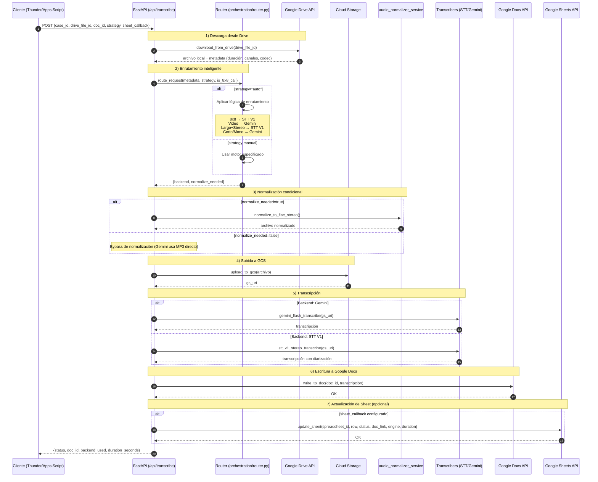

# TMF Audio/Video Transcription API (GCP / Cloud Run ready)

Servicio FastAPI que transcribe audios y videos de Google Drive con **enrutamiento inteligente** de motores de transcripción.

## Características principales

1. **Descarga** audio/video desde Google Drive
2. **Enrutamiento inteligente** que selecciona automáticamente el mejor motor de transcripción:
   - **Gemini 2.5 Flash**: Rápido y económico para audios cortos/mono y videos
   - **STT V1 Stereo**: Óptimo para llamadas telefónicas (8x8) y audios largos en estéreo
3. **Normalización condicional**: Solo se normaliza cuando es necesario (STT requiere FLAC, Gemini consume MP3 directo)
4. **Escribe** la transcripción en **Google Docs** con formato (título, fecha, estilos)
5. **Actualiza Google Sheets** con resultados (estado, enlace, motor usado, duración)
6. Expone **/metrics** (Prometheus), **/health** y **/docs**

> **Cuenta de servicio**: `drive-sheets@ortega-473114.iam.gserviceaccount.com`

---

## 🌳 Estructura clave

```
src/
  api/
    main.py                    # FastAPI app principal
    routes.py                  # POST /api/transcribe (endpoint único)
    schemas.py                 # TranscriptionRequest, TranscriptionResponse
    error_handler.py           # Manejo global de errores
  docs/
    google_docs_service.py     # Escribe transcripciones en Google Docs
  ingestion/
    audio_processor.py         # Descarga desde Drive y extrae metadata
    auth_service.py            # Credenciales Service Account (Drive/Docs/Sheets)
  orchestration/
    runner.py                  # Pipeline principal: run_transcription_pipeline
    router.py                  # Enrutamiento inteligente de motores
  sheets/
    sheets_service.py          # Actualiza Google Sheets con resultados
  storage/
    audio_normalizer_service.py# Normalización condicional a FLAC/WAV
    gcs_uploader.py            # Sube archivos a GCS
    upload_service.py          # Servicio de carga
  transcription/
    transcribers.py            # Motores: Gemini Flash, STT V1 Stereo/Mono
    vertex_service.py          # Cliente Vertex AI
  tools/
    manage_recognizer.py       # CLI para gestionar recognizers de STT
  logging_conf.py
  metrics.py
  settings.py                  # Configuración centralizada
```

## 🧠 Arquitectura

### 1) Vista general (flujo funcional)



### 2) Lógica de enrutamiento

El sistema selecciona automáticamente el mejor motor según las características del archivo:

| Condición | Motor seleccionado | Razón |
|-----------|-------------------|-------|
| `is_8x8_call=true` | **STT V1 Stereo** | Llamadas telefónicas 8x8 requieren separación de canales |
| Extensión `.mp4` | **Gemini Flash** | Videos se procesan directamente sin extracción de audio |
| Duración > 25 min **Y** 2 canales | **STT V1 Stereo** | Audios largos en estéreo necesitan diarización robusta |
| Cualquier otro caso | **Gemini Flash** | Más rápido y económico para audios cortos/mono |

**Normalización condicional:**
- **STT V1**: Siempre normaliza a FLAC estéreo (16kHz)
- **Gemini Flash**: Consume MP3 directamente (bypass de normalización = +60% velocidad)

---

## ⚙️ Prerrequisitos

* **Python 3.11+**
* **Google Cloud Project** con APIs habilitadas:
  * Google Drive API
  * Google Docs API
  * Google Sheets API
  * Cloud Storage
  * Vertex AI API
  * Speech-to-Text API
* **Service Account** con permisos:
  * Acceso **editor** a los Google Docs de destino
  * Acceso **editor** a las Google Sheets (para callbacks)
  * Acceso a archivos de Drive (compartidos o en Shared Drive)
  * `roles/storage.objectAdmin` en el bucket de GCS
  * `roles/aiplatform.user` para Vertex AI

---

## 🔐 Variables de entorno (.env)

Configuración mínima:

```env
# --- GCP / Credenciales ---
GCP_PROJECT_ID=ortega-473114
GCP_REGION=us-central1
GOOGLE_APPLICATION_CREDENTIALS=./credencial/sa.json

# --- Cloud Storage ---
USE_GCS=true
GCS_BUCKET=my-bucket-out
GCS_BUCKET_OUTPUT=my-bucket-out

# --- Motor de transcripción por defecto ---
TRANSCRIBER_ENGINE=stt_v1_stereo  # stt_v1_stereo | gemini_flash

# --- Speech-to-Text ---
STT_LANGUAGE_CODE=es-MX
STT_ENABLE_DIARIZATION=true
STT_MIN_SPEAKERS=2
STT_MAX_SPEAKERS=2
SPEECH_LOCATION=us-central1
SPEECH_RECOGNIZER=projects/ortega-473114/locations/us-central1/recognizers/tmf-recognizer

# --- Rutas locales ---
INPUT_DIR=./data/input
WORK_DIR=./data/work
OUTPUT_DIR=./data/output
```

> **Importante**: No subas `sa.json` ni `.env` al repositorio.

---

## 🚀 Instalación y ejecución local

```bash
# 1. Crear entorno virtual
python -m venv venv
source venv/bin/activate  # Windows: venv\Scripts\activate

# 2. Instalar dependencias
pip install -r requirements.txt

# 3. Configurar variables de entorno
cp .env.example .env
# Edita .env con tus credenciales

# 4. Ejecutar API
uvicorn src.main:app --reload --port 8080
```

**Endpoints disponibles:**
- Health check: `GET http://127.0.0.1:8080/health`
- Service account info: `GET http://127.0.0.1:8080/whoami`
- API docs: `GET http://127.0.0.1:8080/docs`
- Métricas: `GET http://127.0.0.1:8080/metrics`

---

## 📑 Contrato API

### Endpoint único: `POST /api/transcribe`

Acepta audios y videos de Google Drive, con enrutamiento inteligente automático.

**Request body**:

```json
{
  "case_id": "CASE-2024-001",
  "title": "Llamada con cliente - Soporte técnico",
  "drive_file_id": "1abc123xyz456789",
  "doc_id": "1doc987xyz654321",
  "strategy": "auto",
  "language_code": "es-MX",
  "is_8x8_call": false,
  "sheet_callback": {
    "spreadsheet_id": "1sheet789xyz",
    "sheet_name": "Transcripciones",
    "row_index": 5,
    "transcript_doc_col": "E",
    "status_col": "F",
    "engine_col": "G",
    "duration_col": "H"
  }
}
```

**Campos**:
- `case_id`: Identificador único del caso
- `title`: Título para el documento
- `drive_file_id`: ID del archivo en Drive (extraído de la URL)
- `doc_id`: ID del Google Doc de destino
- `strategy`: Estrategia de routing (`"auto"`, `"gemini_flash"`, `"stt_v1_stereo"`)
- `language_code`: Idioma del audio (opcional, default: `"es-MX"`)
- `is_8x8_call`: Forzar STT V1 para llamadas 8x8 (opcional, default: `false`)
- `sheet_callback`: Configuración para actualizar Google Sheets (opcional)

**Response**:

```json
{
  "case_id": "CASE-2024-001",
  "doc_id": "1doc987xyz654321",
  "backend_used": "Gemini 2.5 Flash",
  "duration_seconds": 42.5,
  "status": "success",
  "timestamp": "2025-12-18T10:15:30.123Z",
  "output_files": {
    "google_doc": "https://docs.google.com/document/d/1doc987xyz654321/edit"
  }
}
```

---

## 🎚️ Estrategias de transcripción

### 1. Modo automático (`strategy: "auto"`)

El router selecciona el mejor motor basándose en:
- Tipo de archivo (audio vs. video)
- Duración del contenido
- Número de canales (mono vs. stereo)
- Flag `is_8x8_call`

**Ejemplo**: Audio corto mono → Gemini Flash (rápido + económico)

### 2. Override manual

Puedes forzar un motor específico:

```json
{
  "strategy": "gemini_flash"    // Forzar Gemini
}
```

```json
{
  "strategy": "stt_v1_stereo"   // Forzar STT V1
}
```

### 3. Llamadas 8x8

Para llamadas telefónicas de 8x8 (siempre en estéreo):

```json
{
  "is_8x8_call": true  // Fuerza STT V1 Stereo automáticamente
}
```

---

## 📝 Formato en Google Docs

La transcripción se escribe en el Google Doc especificado con el siguiente formato:

1. **Encabezado**: Título + fecha/hora de transcripción
2. **Cuerpo**: Transcripción formateada según el motor:
   - **STT V1**: Marcas de tiempo + diarización (Agente/Cliente)
   - **Gemini**: Texto corrido con párrafos

**Permisos necesarios**: El documento debe estar compartido con la cuenta de servicio en modo **Editor**, o ubicado en un Shared Drive accesible.

---

## 🧪 Ejemplos rápidos

### 1. Transcripción automática (curl)

```bash
curl -X POST "http://localhost:8080/api/transcribe" \
  -H "Content-Type: application/json" \
  -d '{
    "case_id": "CASE-001",
    "title": "Llamada con cliente",
    "drive_file_id": "1abc123xyz",
    "doc_id": "1doc456xyz",
    "strategy": "auto",
    "language_code": "es-MX"
  }'
```

### 2. Llamada 8x8 (curl)

```bash
curl -X POST "http://localhost:8080/api/transcribe" \
  -H "Content-Type: application/json" \
  -d '{
    "case_id": "8x8-CALL-042",
    "title": "Soporte técnico - Ticket #12345",
    "drive_file_id": "1stereo_call_123",
    "doc_id": "1doc_call_456",
    "is_8x8_call": true,
    "language_code": "es-MX"
  }'
```

### 3. Con callback a Google Sheets (Python)

```python
import requests

response = requests.post(
    "http://localhost:8080/api/transcribe",
    json={
        "case_id": "CASE-099",
        "title": "Entrevista legal",
        "drive_file_id": "1audio_555",
        "doc_id": "1doc_777",
        "strategy": "auto",
        "sheet_callback": {
            "spreadsheet_id": "1sheet_999",
            "sheet_name": "Transcripciones",
            "row_index": 12,
            "transcript_doc_col": "E",
            "status_col": "F",
            "engine_col": "G",
            "duration_col": "H"
        }
    }
)

print(response.json())
```

### 4. Desde Google Apps Script

```javascript
function transcribeAudio(driveFileId, docId) {
  const API_URL = 'https://your-api.run.app/api/transcribe';

  const payload = {
    'case_id': 'GAS-' + new Date().getTime(),
    'title': 'Transcripción desde Apps Script',
    'drive_file_id': driveFileId,
    'doc_id': docId,
    'strategy': 'auto',
    'language_code': 'es-MX'
  };

  const options = {
    'method': 'post',
    'contentType': 'application/json',
    'payload': JSON.stringify(payload),
    'muteHttpExceptions': true
  };

  const response = UrlFetchApp.fetch(API_URL, options);
  const result = JSON.parse(response.getContentText());

  Logger.log('Resultado: ' + JSON.stringify(result));
  return result;
}
```

Para más ejemplos detallados, consulta [API_EXAMPLES.md](./API_EXAMPLES.md).

---

## 📊 Métricas y monitoreo

### Endpoints de salud

- `GET /health` → Estado del servicio
- `GET /whoami` → Información de la cuenta de servicio
- `GET /metrics` → Métricas Prometheus

### Métricas disponibles

- Latencias de transcripción por motor
- Conteos de éxito/error
- Tiempos de normalización
- Uso de enrutamiento (auto vs. manual)

---

## 🧯 Troubleshooting

### Error: "No se pudo descargar el archivo de Drive"

**Causa**: Archivo no compartido con la cuenta de servicio o ID incorrecto.

**Solución**:
1. Verifica que el `drive_file_id` es correcto
2. Comparte el archivo con `drive-sheets@ortega-473114.iam.gserviceaccount.com` en modo Lector
3. O coloca el archivo en un Shared Drive accesible

### Error: "No se pudo escribir en el documento"

**Causa**: Google Doc no compartido con la cuenta de servicio.

**Solución**:
1. Comparte el documento con `drive-sheets@ortega-473114.iam.gserviceaccount.com` en modo **Editor**
2. O crea el documento en un Shared Drive accesible

### Error: "Failed to update Google Sheet"

**Causa**: Hoja no compartida o configuración incorrecta del callback.

**Solución**:
1. Comparte la hoja con la cuenta de servicio en modo Editor
2. Verifica que `sheet_name` coincide exactamente con el nombre de la pestaña
3. Verifica que las columnas especificadas (`E`, `F`, `G`, `H`) son válidas

### Rendimiento: Transcripciones lentas

**Posibles causas**:
1. Normalización innecesaria activada para Gemini
2. Archivos muy grandes sin compresión

**Solución**:
- Usa `strategy: "gemini_flash"` para audios cortos (evita normalización)
- Comprime videos antes de subirlos a Drive

---

## 🏭 Despliegue en Cloud Run

### Pasos básicos

1. **Construir imagen Docker**:
   ```bash
   gcloud builds submit --tag gcr.io/ortega-473114/transcription-api
   ```

2. **Desplegar en Cloud Run**:
   ```bash
   gcloud run deploy transcription-api \
     --image gcr.io/ortega-473114/transcription-api \
     --region us-central1 \
     --platform managed \
     --allow-unauthenticated \
     --memory 2Gi \
     --timeout 900
   ```

3. **Configurar variables de entorno** en la consola de Cloud Run:
   - `GCP_PROJECT_ID`
   - `GCP_REGION`
   - `GCS_BUCKET`
   - `SPEECH_RECOGNIZER`
   - `TRANSCRIBER_ENGINE`

4. **Montar credenciales** como Secret Manager:
   ```bash
   gcloud secrets create service-account-key --data-file=./credencial/sa.json
   ```

Para más detalles, consulta [DEPLOYMENT_GUIDE.md](./DEPLOYMENT_GUIDE.md).

---

## 🛠️ Herramientas CLI

### Gestión de recognizers STT

```bash
# Listar recognizers
python -m src.tools.manage_recognizer list

# Crear recognizer
python -m src.tools.manage_recognizer create \
  --name tmf-recognizer \
  --location us-central1

# Eliminar recognizer
python -m src.tools.manage_recognizer delete \
  --name tmf-recognizer \
  --location us-central1
```

---

## 📄 Documentación adicional

- [API_EXAMPLES.md](./API_EXAMPLES.md) - Ejemplos completos de uso de la API
- [DEPLOYMENT_GUIDE.md](./DEPLOYMENT_GUIDE.md) - Guía detallada de despliegue

---

## 📝 Licencia

Proyecto interno de TMF.

---

## 📊 Changelog

### v2.0 (Diciembre 2025)
- ✨ Enrutamiento inteligente automático de motores
- ✨ Integración con Google Sheets (callbacks)
- ✨ Normalización condicional (bypass para Gemini)
- ✨ Endpoint único `/api/transcribe`
- ✨ Soporte nativo para videos (.mp4)
- 🐛 Corrección de manejo de errores
- 📝 Refactorización completa del código
